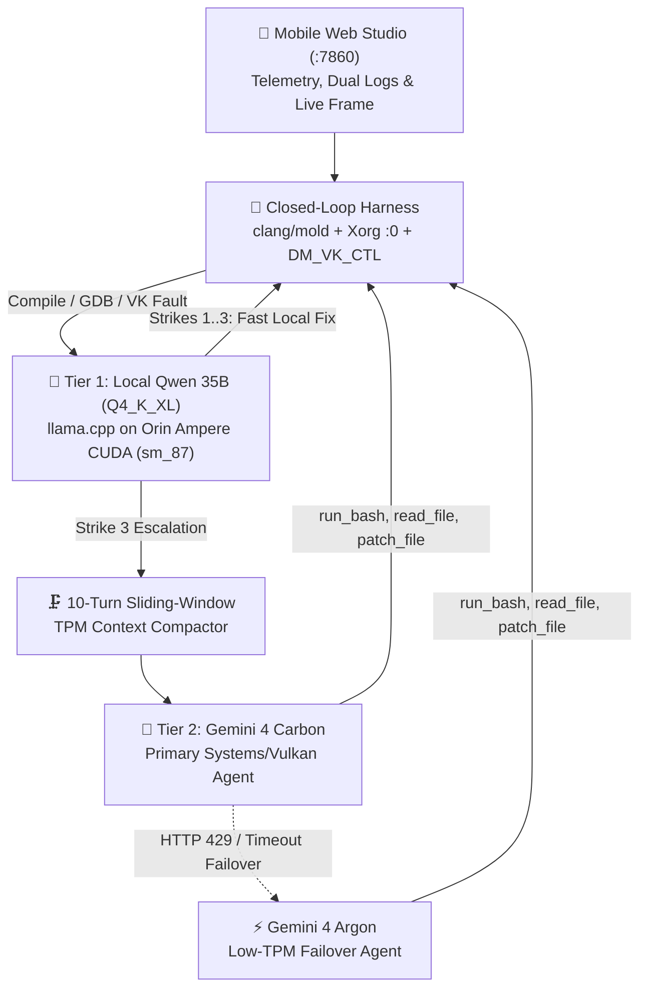

# ⚡ OrinConductor & OrinNative Linux/Vulkan Layer

**Autonomous Edge-to-Cloud AI Systems Orchestrator & Native AArch64 / Vulkan 1.4 Runtime Port on NVIDIA Jetson AGX Orin 32GB**

_%2B_Gemini_Carbon%2FArgon-4285F4?style=flat-square)

---

## 📌 Overview

Built on an **NVIDIA Jetson AGX Orin 32GB** (8x Cortex-A78AE, 1792-core Ampere `GA10B` GPU, L4T 595.78 / Vulkan 1.4), this repository showcases two integrated engineering systems:

1. **`OrinConductor` (`orin_conductor.py`, `launch_game.sh`, `scripts/`, `systemd/`):**
   An autonomous debugging orchestrator and mobile-first Web UI (`:7860`) featuring a **3-strike local-to-cloud AI escalation pipeline**. Fast compile/GDB triage runs at $0.00 cost on a local quantized **Qwen 35B** model (`llama-server` on Orin CUDA `sm_87`), escalating after 3 failed strikes to cloud tool-use agents (**Gemini 4 Carbon / Argon**) with **10-turn sliding-window TPM compaction** and automatic rate-limit failover.
2. **`OrinNative` Linux AArch64 & Vulkan 1.4 Backend (`linux_port/`, `vulkan_backend/`):**
   Native Linux AArch64 platform (`plat_linux.c`, `front_linux.c`, `movie_linux.c`) and Vulkan 1.4 driver extensions (`vka_tex.c`, `vka_draw.c`, `vka_ixc_spv.h`, `vka_pso.c`), achieving **60 FPS (`4.3–5.3 ms` GPU frame time)** in commercial 3D engines.

---

## 🏗️ Architecture: 3-Strike Local Qwen (CUDA) → Cloud Carbon/Argon Loop

---

## 📊 Key Engineering Metrics & Benchmarks

| Subsystem / Metric | Result on Jetson AGX Orin 32GB |
| :--- | :--- |
| **3D Rendering Throughput** | **60 FPS** (`4.3–5.3 ms` Ampere GPU frame time) |
| **Vulkan Pipeline Cache Prewarm** | **743 pipelines** (53.2 MB cache) prewarmed in **183 ms** |
| **Host Incremental Rebuild Time** | **< 2.0 sec** (`clang` + `mold` linker + `ccache`) |
| **Token-Per-Minute (TPM) Compaction** | Reduced 80-turn agent bursts from **2.43M TPM → <350K TPM (~75% reduction)** |
| **Thermal / Power Scheduling** | Automated `nvpmodel` switching: **15W Eco Sleep** ↔ **MAXN Super Mode** |

---

## 🔬 Deep-Dive Engineering Case Studies

1. **AArch64 `tpidr_el0` TLS Slotting & Static Binary Layout (`linux_port/plat_linux.c`, `Makefile`):**
   Resolved guest-vs-`glibc` ARMv8 `tpidr_el0` Thread-Local Storage register collisions via `+16` byte TLS slot alignment, `pthread_t + 0xd0` / `SYS_gettid` resolution, and `-fno-pie -no-pie` deterministic address mapping.
2. **Zero-Copy Unified Memory Aliasing (`linux_port/plat_linux.c`):**
   Backed guest physical memory with `memfd_create()` shared memory views imported directly into Vulkan via `VK_KHR_external_memory_fd` (`DM_VK_POOL_CACHED=1`), eliminating staging copies across the Orin's 32GB LPDDR5 memory.
3. **Vulkan 1.4 Texel Buffers & SPIR-V Indirect Quad Expansion (`vulkan_backend/`):**
   Implemented 1D-to-2D row-wrapped texel buffer fallback views (`target 10` in `vka_tex.c`/`vka_bind.c`), inline SPIR-V compute shaders (`vka_ixc_spv.h`) to expand indirect `QUADS` draws into indexed triangles on the GPU (`vka_draw.c`), and per-MRT blend state fixes (`vka_pso.c`).

---

## 📂 Repository Layout

* `orin_conductor.py` — v4 Autonomous Orchestrator, Tool Loop, TPM Compactor & Mobile Web Studio (`:7860`)
* `launch_game.sh` — Incremental build, shader packer & headless `Xorg :0` launcher
* `linux_port/` — Native Linux AArch64 platform (`plat_linux.c`), SDL3/X11 frontend (`front_linux.c`), media decode (`movie_linux.c`), and `Makefile`
* `vulkan_backend/` — Ampere Vulkan 1.4 texture buffer views (`vka_tex.c`, `vka_bind.c`), indirect quad SPIR-V expansion (`vka_draw.c`, `vka_ixc_spv.h`), and PSO management (`vka_pso.c`)
* `scripts/` — Local `llama-server` Qwen 35B CUDA launcher (`start_llm.sh`), `orin-power-mode`, and `build_safe.sh`
* `systemd/` — Self-healing `orin-conductor.service` unit

## 👤 Author
**Chase Oswalt** — [chaseogit.github.io](https://chaseogit.github.io) | [@chaseogit](https://github.com/chaseogit)
